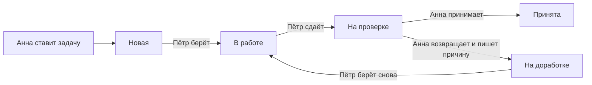

# Как это работает

Этот текст для руководителя, который не пишет программы. Технических слов здесь нет. Подробности для разработчика лежат в соседних файлах папки `docs`.

## Что это за сайт

Строительная компания ведёт на сайте задачи по стройкам. Начальник ставит задачу, рабочий выполняет её и сдаёт, начальник принимает работу или возвращает на исправление. Каждый шаг записывается: кто сделал, когда и что написал.

## Кто участвует

Возьмём пример: начальник Анна, рабочие Пётр и Сергей, стройка ЖК Северный.

| Кто | Как это называется на сайте | Что делает |
|---|---|---|
| Анна, начальник | постановщик | заводит стройки и задачи, назначает рабочих, принимает работу или возвращает её |
| Пётр, рабочий | исполнитель | берёт свои задачи в работу и сдаёт на проверку |
| Сергей, рабочий | исполнитель | делает то же самое со своими задачами |
| ЖК Северный, стройка | объект | у стройки есть название, адрес и список задач |

Начальников и рабочих может быть несколько. Все начальники равны: принять работу может любой из них, даже если задачу ставил другой.

## Как идёт задача

Задачи лежат на доске, как листы на стене в прорабской. Каждая колонка доски отвечает за один этап, задача переезжает из колонки в колонку. Этапов пять.

По шагам:

1. Анна открывает ЖК Северный и создаёт задачу «Смонтировать опалубку», назначает Петра. Задача появляется на этапе «Новая». Имя автора и дату ставит сам сайт, вписать их вручную нельзя.
2. Пётр входит на сайт и сразу видит свои задачи. У задачи, которая ждёт его действия, справа сверху нарисован крюк крана. Пётр нажимает на ней «В работу», и задача переезжает в колонку «В работе».
3. Когда опалубка готова, Пётр открывает задачу и нажимает «Отправить на проверку». Там же можно оставить заметку, например: «Готово, можно смотреть».
4. У Анны на чёрном блоке «Ждут проверки» стоит число таких задач. Она нажимает на блок, получает список и прямо в нём решает: «Принять» или «Вернуть».
5. Анна нажимает «Принять». Задача принята, дальше она никуда не двигается.

Перепрыгнуть этап нельзя. Из «Новой» задача идёт только в «В работе», из «В работе» только на проверку.

## Что происходит при возврате

Допустим, щиты опалубки стоят криво.

1. Анна нажимает «Вернуть». Сайт открывает окно с вопросом, что нужно исправить. Без текста вернуть нельзя.
2. Задача уходит на этап «На доработке». У Петра она лежит первой в колонке «Новая», с меткой «Доработка», поэтому он её не пропустит. Причину возврата он видит, когда открывает задачу.
3. Пётр снова берёт задачу в работу, исправляет и отправляет на проверку.
4. Пока задачу не приняли, у неё тёплый фон, штриховка и метка «Доработка». Анна сразу видит, что эту задачу уже возвращали, а причина написана внутри задачи.
5. Анна принимает. Вид становится обычным, запись о возврате остаётся в истории задачи.

Возвращать одну задачу можно сколько угодно раз.

## Передумать можно 10 секунд

После смены этапа внизу экрана появляются надпись вида «Задача теперь «Принята»», кнопка «Отменить» и полоса отсчёта на 10 секунд.

Пока полоса идёт, изменение никуда не записано. Нажали «Отменить», и всё осталось как было, в истории следа нет.

Через 10 секунд изменение записывается насовсем. Дальше назад пути нет: задание разрешает только перечисленные выше переходы.

Два случая, которые стоит знать:

- Если за эти 10 секунд закрыть вкладку, изменение не запишется и задача останется на прежнем этапе.
- Если за эти 10 секунд сделать следующее действие, предыдущее запишется сразу и отменить его уже нельзя.

## Что ещё может начальник

- Поправить задачу на любом этапе: текст, стройку, рабочего. Этап от этого не меняется. Каждая правка записывается в историю: кто, когда, что было, что стало.
- Назначить рабочего позже. Пока рабочий не назначен, такую задачу видят только начальники.
- Назначить на задачу себя, выполнить её и самому принять.
- Удалить задачу или стройку. Сайт сначала переспросит, а у стройки покажет, сколько задач скроется вместе с ней. Удалённое пропадает с экранов у всех, но запись и история сохраняются в хранилище данных.

## Кто что видит

| Что | Анна | Пётр | Сергей |
|---|---|---|---|
| ЖК Северный | видит | видит, там есть его задачи | не видит, там нет его задач |
| Задача Петра | видит | видит | не видит |
| История задачи Петра | видит | видит | не видит |
| Задача без рабочего | видит | не видит | не видит |

Если Анна передаст задачу от Петра Сергею, у Петра задача пропадёт вместе с историей, а у Сергея появится со всей историей. Стройка останется в списке у Петра, только если там есть другие его задачи.

## Почему нельзя схитрить

Кнопки на экране ничего не охраняют, они только подсказывают, что можно нажать. Правила проверяет хранилище данных, куда сайт обращается за каждой записью.

Сравнение: проходная на стройке. Пропуск можно нарисовать какой угодно, решает охранник у ворот со своим списком. Человек, который разбирается в программах и отправит команду мимо сайта, придёт к тому же охраннику.

Примеры:

- Пётр хочет сам принять свою работу. Кнопки у него нет. Если отправить команду мимо сайта, придёт отказ: это доступно постановщику.
- Пётр хочет открыть задачу Сергея по прямой ссылке. Ему ответят, что такой задачи нет. Существует она или нет, он не узнает.
- Сергей хочет отправить задачу из «Новой» сразу на проверку, минуя работу. Придёт отказ с объяснением, куда задача может идти дальше.
- Анна хочет отметить новую задачу принятой, минуя рабочего. Ей тоже откажут: порядок этапов один для всех.
- Кто-то хочет стереть из истории неудобный возврат или вписать чужое имя. Историю нельзя ни поправить, ни удалить. Записи в неё делает сама система, имя и время она тоже ставит сама.
- Посторонний хочет зарегистрироваться. Регистрации нет, пользователей заводит администратор. Без входа не видно ничего.

## Что открыто намеренно

На странице входа есть блок быстрого входа под тремя тестовыми людьми: нажали на имя и вошли. Это тестовая площадка, блок сделан, чтобы проверяющему не вводить пароль. Любой, кто открыл страницу, может войти как Анна и менять тестовые данные.

В настоящей работе этот блок убирается одной настройкой, остаётся обычный вход по почте и паролю.
