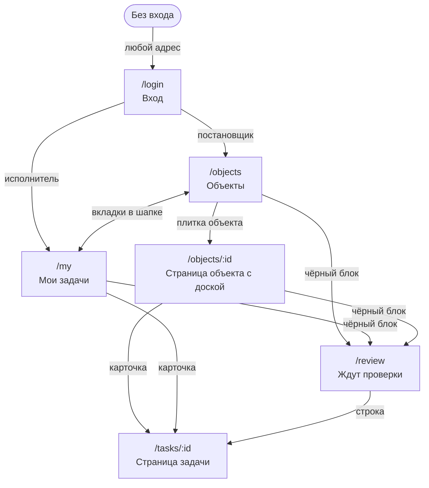

# Карта сайта

Здесь перечислены экраны и адреса сайта: что на каждом экране видит постановщик и что видит исполнитель.

Слова, которые встречаются ниже:

- Постановщик: тот, кто ставит задачи и принимает работу. Исполнитель: тот, кто выполняет назначенные ему задачи.
- Объект: стройка.
- Статус: этап задачи. Их пять: «Новая», «В работе», «На проверке», «На доработке», «Принята».
- Доска: экран с колонками, каждая колонка отвечает за один статус.
- Карточка: прямоугольник с задачей на доске.
- Страница задачи: отдельный экран одной задачи. В ТЗ он называется «Карточка задачи».
- Плитка: прямоугольный блок на экране, из таких блоков собран весь сайт.
- Крюк: значок крана в правом верхнем углу карточки. Он означает, что задача ждёт вашего действия.
- Второй круг: задачу хотя бы раз возвращали на доработку, и её ещё не приняли.

## Схема переходов

Вкладки «Объекты» и «Мои задачи» в шапке есть на всех экранах после входа и у постановщика, и у исполнителя. Адреса одни и те же для обеих ролей: разное только содержимое.

Без входа любой адрес ведёт на `/login`. После входа постановщик попадает на `/objects`, исполнитель на `/my`. Неизвестный адрес показывает экран «Здесь ничего нет» с кнопкой «К объектам».

## Адреса

| Адрес | Экран | Что на нём главное |
|---|---|---|
| `/login` | Вход | почта и пароль, быстрый вход под тестовыми пользователями |
| `/objects` | Объекты | сводка и плитки объектов |
| `/objects/:id` | Страница объекта | шапка объекта и доска его задач |
| `/tasks/:id` | Страница задачи | данные, действия, история |
| `/my` | Мои задачи | доска задач, где вы исполнитель |
| `/review` | Ждут проверки | задачи на проверке строками по всем доступным объектам |

## Вход, `/login`

Экран одинаковый для всех, кто ещё не вошёл:

- работающий кран строит здание;
- форма с почтой и паролем, регистрации нет;
- блок «Демо-пользователи»: нажатие на имя сразу входит под этим пользователем;
- плитка «Как идёт задача» с четырьмя шагами.

Блок «Демо-пользователи» появляется, только если задан общий пароль в настройке `VITE_DEMO_PASSWORD`. Почему он есть, написано в [docs/05-resheniya-i-dopushcheniya.md](05-resheniya-i-dopushcheniya.md).

## Объекты, `/objects`

| Что на экране | Постановщик | Исполнитель |
|---|---|---|
| Плитки объектов | все неудалённые объекты | только объекты, где есть его задача |
| Чёрный блок «Ждут проверки» | число задач на проверке по всем объектам | число его задач на проверке |
| Плитка «Готовность» | доля принятых задач по всем объектам | доля принятых среди его задач |
| Плитка «Ваш ход» | нет | число его задач, которые ждут его действия, нажатие ведёт в «Мои задачи» |
| Плитка «Добавить объект» | есть | нет |

На плитке объекта есть название, адрес, число задач, сколько задач ждёт проверки, метка «На доработке», рисунок здания и процент принятых задач. Нажатие открывает страницу объекта.

Пустой экран говорит постановщику: «Добавьте первый объект, и здесь вырастет его здание». Исполнителю: «Вас пока не назначили ни на один объект».

## Страница объекта, `/objects/:id`

| Что на экране | Постановщик | Исполнитель |
|---|---|---|
| Название, адрес, метки | есть | есть |
| «Ждут проверки» и «Готовность» | по всем задачам объекта | только по его задачам на этом объекте |
| Значки «Изменить объект» и «Удалить объект» | есть | нет |
| Плитка «Ваш ход» | нет | есть |
| Доска | все задачи объекта, пять колонок | только его задачи, четыре колонки |
| «Создать задачу» в колонке «Новая» | есть | нет |

Пустой экран: «На этом объекте пока нет задач». У постановщика на нём есть кнопка «Создать задачу».

Исполнитель, который открыл по ссылке чужой объект, видит экран «Здесь ничего нет» с кнопкой «Все объекты»: база не отдала ему такую запись.

## Страница задачи, `/tasks/:id`

| Часть экрана | Постановщик | Исполнитель |
|---|---|---|
| Название и описание | правит прямо на месте, сохраняется при уходе из поля, пустое название не сохраняется. Описание в редакторе: жирный, курсив, заголовок, списки, картинки кнопкой, вставкой и перетаскиванием | только читает, картинки видит |
| Исполнитель и объект | выбирает из списка с аватарками | только читает |
| Автор и дата создания | читает | читает |
| Маршрут статусов | видит | видит |
| История | видит | видит |
| Причина возврата | видит сверху блока действий, пока задача на втором круге | так же |
| Значок «Удалить задачу» | есть | нет |

Блок действий показывает только кнопки, которые положены этому человеку в этом статусе:

| Статус | Любой постановщик | Назначенный исполнитель |
|---|---|---|
| Новая | нет | «Взять в работу» |
| В работе | нет | «Отправить на проверку» |
| На проверке | «Принять», «Вернуть на доработку» | нет |
| На доработке | нет | «Снова взять в работу» |
| Принята | нет | нет |

Постановщик, которого назначили исполнителем этой задачи, видит кнопки из обеих колонок.

Рядом с кнопками есть поле комментария. При возврате на доработку оно обязательно, в остальных случаях нет.

Если действий нет, вместо кнопок написано, чего ждёт задача: «Сейчас ход исполнителя: Пётр.», «Задача на проверке у постановщика.», «Исполнитель пока не назначен.» или «Задача принята, дальше действий нет.»

## Мои задачи, `/my`

Вкладка есть у обеих ролей. На доске только задачи, где вы назначены исполнителем: у исполнителя это его работа, у постановщика задачи, которые он взял на себя.

На вкладке стоит счётчик: сколько ваших задач ждут вашего действия. На карточке подписан объект, а на доске объекта подписан исполнитель.

Пустой экран: «Вам пока не назначили задач».

## Ждут проверки, `/review`

Экран открывается нажатием на чёрный блок. Задачи идут строками по всем доступным объектам.

| | Постановщик | Исполнитель |
|---|---|---|
| Какие задачи | все задачи на проверке | его задачи на проверке |
| Кнопки в строке | «Принять» и «Вернуть» | нет |

Пустой экран: «Сейчас ничего не ждёт проверки».

## Чем отличаются доски

| | Новая | В работе | На проверке | На доработке | Принята |
|---|---|---|---|---|---|
| Постановщик | новые задачи | задачи в работе | задачи на проверке | возвращённые задачи | принятые задачи |
| Исполнитель | новые и возвращённые, возвращённые первыми | задачи в работе | задачи на проверке | колонки нет | принятые задачи |

У исполнителя колонки «На доработке» нет только на экране. Статус возвращённой задачи в базе остаётся «На доработке», это видно на странице задачи и в истории.

Остальное на доске работает так:

- Карточку можно перетащить, если у вас есть для неё действие. Бросок в разрешённую колонку работает как нажатие кнопки.
- Бросок в запрещённую колонку возвращает карточку на место и объясняет почему, например: «Так нельзя: из «На проверке» задача идёт только в «Принята» или «На доработке».»
- Бросок на «На доработке» сначала открывает окно с комментарием.
- На карточке есть те же действия кнопками, подписи короче: «В работу», «На проверку», «Принять», «Вернуть». На доске и на экране «Ждут проверки» кнопки срабатывают без поля комментария, кроме «Вернуть»: там окно с комментарием. Комментарий к любому другому действию пишут на странице задачи.
- На карточке без исполнителя постановщик видит кнопку «Назначить».
- Задача на втором круге выглядит иначе: тёплый фон, штриховка, метка «Доработка». В колонке «Принята» вид обычный.

## Окна

| Окно | Кто видит | Что в нём |
|---|---|---|
| Новый объект, Изменить объект | постановщик | название и адрес |
| Новая задача | постановщик | название, описание в редакторе с картинками, объект, исполнитель |
| Вернуть на доработку | постановщик | поле «Что нужно исправить», без текста не сохраняется |
| Удалить объект | постановщик | сколько задач скроется вместе с объектом и их список |
| Удалить задачу | постановщик | подтверждение |

Отмена смены статуса окном не считается: это полоска внизу экрана с кнопкой «Отменить» на 10 секунд.

## Состояния экранов

- Загрузка: надпись «Загружаем…».
- Ошибка загрузки: текст и кнопка «Повторить».
- Пусто: свой текст на каждом экране и в каждой колонке.
- Нет доступа или запись не найдена: экран «Здесь ничего нет». База не различает эти случаи, поэтому сайт тоже не различает.
- База отказала в действии: сайт показывает её текст человеческим языком, коды ошибок не показывает.
- Пропала связь или база отказала при смене статуса: карточка возвращается на место, написанный комментарий не теряется. Окно возврата открывается снова с этим текстом, на странице задачи текст возвращается в поле.
- Пользователь вошёл, но профиля у него нет: экран «Профиль не найден» с кнопкой «Выйти».

## Телефон

- Рабочая часть экрана видна сразу, шапка занимает одну строку.
- Плитка «Готовность» и маршрут статусов на телефоне скрыты, сводка идёт двумя маленькими плитками.
- Доска идёт списком, пустые статусы скрыты, статусы с карточками, которые ждут вашего действия, стоят первыми.
- Перетаскивания касанием нет, на телефоне работают кнопки. Кнопки не ниже 44 пикселей.
