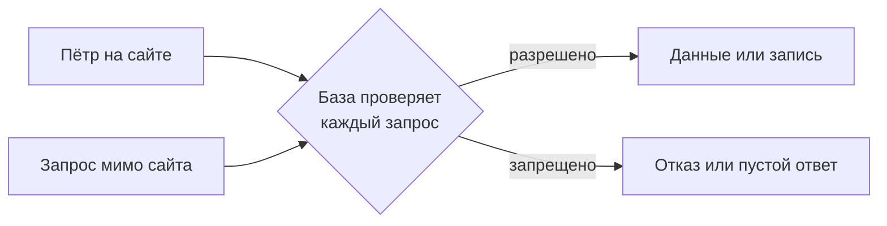
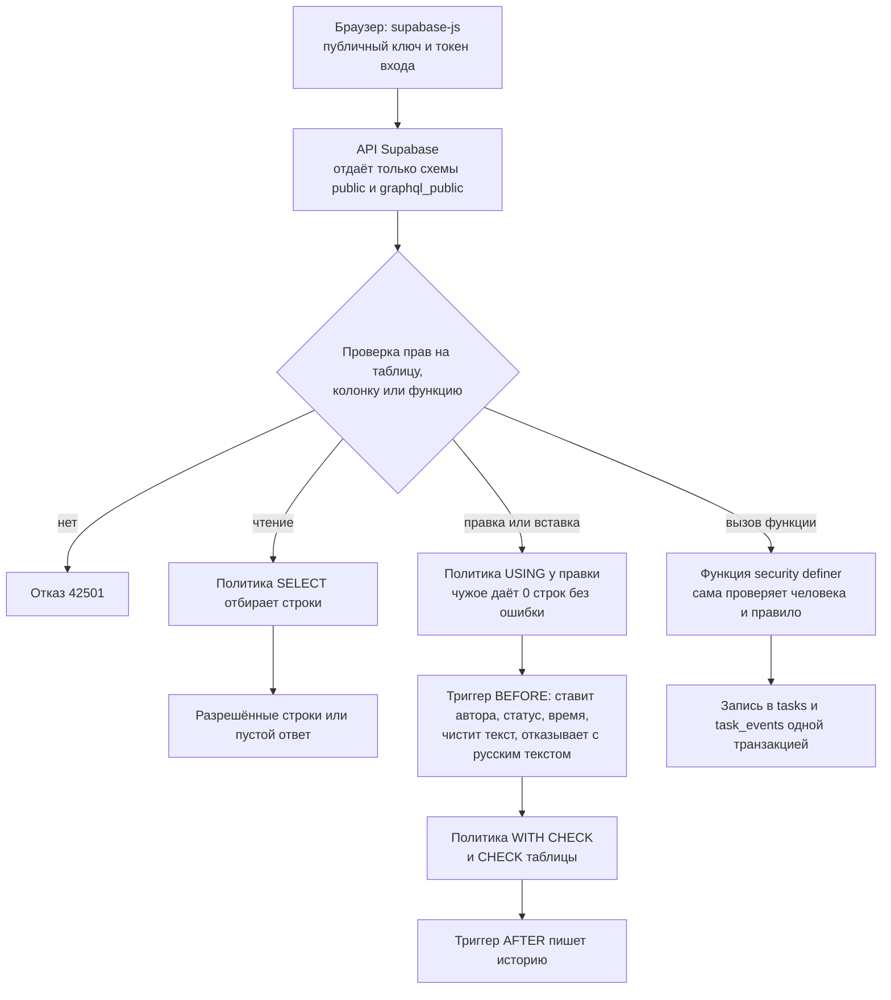
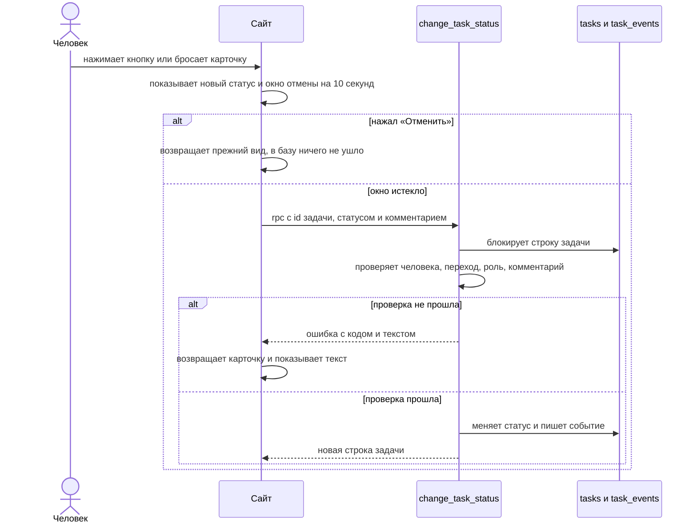
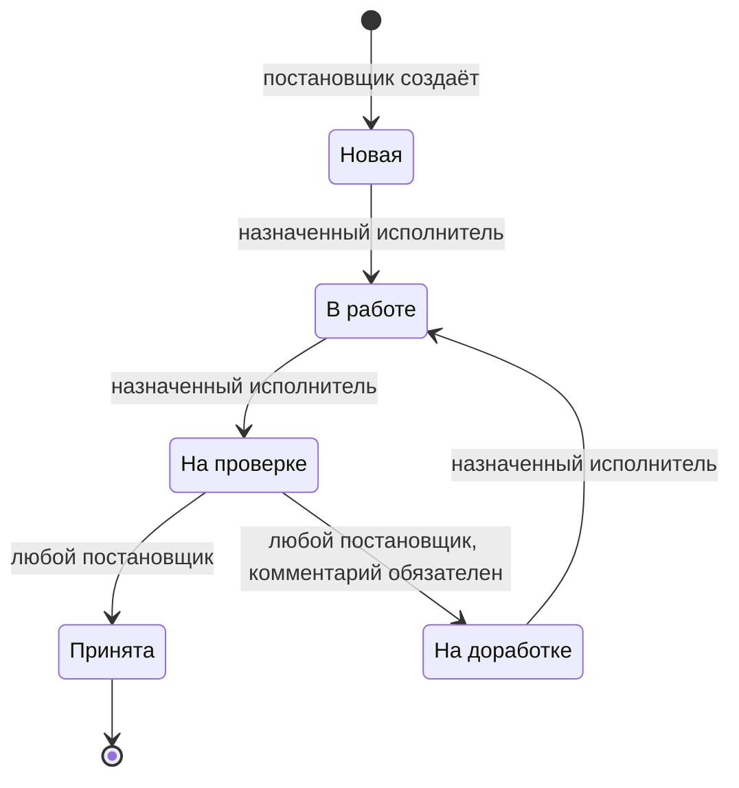

# Защита данных

Первая часть написана для всех, вторая для разработчика. Каждое утверждение здесь опирается на миграции из `supabase/migrations` и тесты из `supabase/tests`. Где проверка только настройкой, так и написано.

## Простыми словами

Данные лежат в базе (база данных: программа, которая хранит записи и сама решает, кому их отдать). Сайт показывает только то, что база отдала вошедшему человеку.

Скрытая кнопка сама по себе ничего не защищает: запрос можно отправить и мимо сайта. ТЗ требует закрыть именно это: «Правила доступа должны работать, даже если обращаться к Supabase напрямую, в обход интерфейса.» Поэтому правила записаны в самой базе.

Каждый запрос идёт от имени вошедшего человека. База знает, кто это и какая у него роль. Роль она берёт из своей таблицы, на неё не влияет то, что прислал браузер.

## Что не может исполнитель

В примере Пётр и Сергей исполнители, Анна постановщик.

Чужие данные:

- Пётр попробует открыть задачу Сергея: база ответит, что такой задачи нет.
- Пётр попробует открыть объект, где у него нет задач: база вернёт пустой ответ, сайт покажет «Здесь ничего нет».
- Пётр попробует прочитать историю задачи Сергея: база вернёт пустой ответ.
- Пётр попробует сменить статус задачи Сергея: база ответит «Задача не найдена». О том, что задача существует, он не узнает.
- Анна передала задачу Петра Сергею: у Петра пропадают задача и её история, а объект пропадает, если других его задач там нет.

Задача без исполнителя:

- Пётр попробует взять в работу задачу без исполнителя: база ответит «Задача не найдена», такие задачи видят только постановщики.
- Пётр попробует назначить такую задачу на себя: база не изменит ни одной строки.

Своя задача:

- Пётр попробует принять свою работу или вернуть её: база ответит «Это действие доступно постановщику».
- Пётр попробует перевести свою задачу из «Новая» сразу на проверку: база ответит «Так нельзя: из «Новая» задача идёт только в «В работе».»
- Пётр попробует исправить название или описание своей задачи: база не изменит ни одной строки.

Создание и удаление:

- Пётр попробует создать задачу или объект: база ответит «Это действие доступно постановщику».
- Пётр попробует удалить задачу или объект: база откажет.

История и роли:

- Пётр попробует дописать в историю запись от имени Анны: база откажет.
- Пётр попробует исправить или удалить запись истории: база откажет.
- Пётр попробует сделать себя постановщиком в таблице пользователей: база откажет.
- Пётр подделает роль в своём пропуске (токен: цифровой пропуск, который браузер получает при входе): база всё равно считает его исполнителем.

## Что не может постановщик

У Анны прав больше, но правила пути и история действуют и на неё.

- Анна попробует поставить задаче статус напрямую, мимо функции смены статуса: база откажет.
- Анна попробует принять новую задачу, минуя работу: база ответит «Так нельзя: из «Новая» задача идёт только в «В работе».»
- Анна попробует взять в работу задачу Петра: база ответит «Это может сделать только назначенный исполнитель».
- Анна попробует вернуть задачу без комментария: база ответит «Напишите, что нужно исправить: без комментария вернуть нельзя.» Пробелы и переводы строк комментарием не считаются.
- Анна попробует подменить автора или дату создания задачи: база откажет.
- Анна попробует исправить или стереть запись истории: база откажет.
- Анна попробует стереть задачу из базы насовсем: база откажет. Удаление только скрывает.
- Анна попробует снять исполнителя у задачи, которая уже не «Новая»: база ответит «Снять исполнителя можно только у новой задачи.»
- Анна попробует сменить роль в таблице пользователей: база откажет.

## Что не может посторонний

- Без входа нельзя прочитать ни одну таблицу и вызвать ни одну функцию.
- Зарегистрироваться нельзя: на сайте нет такой формы, в настройках сервиса входа регистрация выключена.
- Человек, который вошёл, но для которого не заведён профиль, не видит задач и объектов и ничего не может создать.

## Что открыто намеренно

- Все вошедшие видят имена и роли всех пользователей: имена нужны в истории и при выборе исполнителя. Почта в этой таблице не хранится.
- На тестовой площадке есть быстрый вход под тремя демо-пользователями. Пароль лежит в коде страницы, войти может любой посетитель. Обычному посетителю это даёт права демо-пользователя и ничего сверх них. Сменить пароль или почту этих трёх пользователей нельзя, запрет стоит в самой базе: иначе один посетитель закрыл бы вход всем остальным. Это решение владельца, подробности в [docs/05-resheniya-i-dopushcheniya.md](05-resheniya-i-dopushcheniya.md).

## Смена объекта в истории

Анна перенесла задачу Петра с ЖК Северный на Склад. Запись об этом хранит оба названия, поэтому её видит только постановщик: Пётр мог не работать на ЖК Северный. Смены статуса и другие правки своей задачи исполнитель видит как обычно.

## Картинки в описании задачи

Анна добавляет в описание задачи снимок дефекта. Файл лежит в закрытом хранилище, ссылки «для всех» у него нет. Пётр открывает задачу и видит снимок, потому что задача его. Сергей этот снимок не откроет, даже если узнает имя файла и отправит запрос мимо сайта: база проверяет, видит ли он задачу с этой картинкой. Если Анна уберёт снимок из описания, Пётр тоже перестанет его получать.

Загружать может только постановщик, только JPG, PNG и WebP, до 5 МБ, всего не больше 200 файлов. Заменить или удалить файл через API нельзя никому. SVG запрещён, потому что внутри него может быть программа. Сайт показывает картинку только из этого хранилища, поэтому текст описания не заставит браузер обратиться на чужой адрес. HTML в описании остаётся текстом и не выполняется.

## Для разработчика

Термины этого раздела:

- RLS (row level security): правила в самой базе, какие строки таблицы видит и меняет пользователь.
- Политика (policy): одно такое правило.
- Триггер: код базы, который запускается сам при записи в таблицу.
- `security definer`: функция работает с правами своего владельца. Поэтому свои проверки она делает сама.
- API: сервис Supabase, через который браузер обращается к базе.

### Путь запроса

Смена статуса идёт так:

### Кто что может

Таблица по миграциям и тестам. Пустой ответ и 0 строк это отказ без ошибки: так работает RLS.

| Действие | Постановщик | Назначенный исполнитель | Чужой исполнитель | Без входа | Секретный ключ |
|---|---|---|---|---|---|
| Чтение `objects`, `tasks`, `task_events`, `task_board` | всё неудалённое | только своё | пусто | 42501 | чтение |
| Чтение `profiles` | да | да | да | 42501 | чтение и запись |
| Вставка в `objects`, `tasks` | да, разрешённые колонки | 42501 с текстом | 42501 с текстом | 42501 | 42501 |
| Правка `objects`, `tasks` | да, разрешённые колонки | 0 строк | 0 строк | 42501 | 42501 |
| Запись `status`, `deleted_at`, `author_id`, `created_by`, `created_at`, `id` | 42501 | 42501 | 42501 | 42501 | 42501 |
| `change_task_status` | принять и вернуть, если назначен, то и шаги исполнителя | свои шаги | PT404 | 42501 | 42501 |
| `delete_task`, `delete_object` | да | 42501 с текстом | 42501 с текстом | 42501 | 42501 |
| Запись в `task_events` | 42501 | 42501 | 42501 | 42501 | 42501 |
| `DELETE` из `objects`, `tasks` | 42501 | 42501 | 42501 | 42501 | 42501 |

### Матрица переходов

Та же матрица таблицей. Строка: откуда, колонка: куда. Диагональ и все остальные клетки запрещены.

| Откуда | Новая | В работе | На проверке | На доработке | Принята |
|---|---|---|---|---|---|
| Новая | нет | исполнитель | нет | нет | нет |
| В работе | нет | нет | исполнитель | нет | нет |
| На проверке | нет | нет | нет | постановщик, с комментарием | постановщик |
| На доработке | нет | исполнитель | нет | нет | нет |
| Принята | нет | нет | нет | нет | нет |

Что получает клиент при отказе, в порядке проверок:

1. Нет входа: 42501, функция для `anon` закрыта.
2. Задачи нет, она удалена или человек её не видит: PT404 «Задача не найдена».
3. Переход не из матрицы: P0001 «Так нельзя: …».
4. Переход есть, но не для этого человека: 42501.
5. Возврат без комментария: 23514.

Тест `01_transitions.test.sql` проходит 125 сочетаний: 5 статусов «откуда», 5 статусов «куда», 5 действующих лиц (постановщик, постановщик назначен исполнителем, назначенный исполнитель, чужой исполнитель, без входа). В каждом сочетании он сверяет код ответа, статус после попытки и число новых событий. Ожидания записаны в тесте отдельно от кода функции.

### Функция смены статуса

`public.change_task_status(p_task_id uuid, p_to task_status, p_comment text default null)` лежит в `20261105120300_task_functions.sql`. Это единственный путь сменить статус: у клиентов нет прав на колонку `status`, а функция работает как `security definer` с пустым `search_path`.

Что она делает по порядку:

1. Читает задачу с `for update`. Два одновременных перехода идут по очереди, второй видит уже новый статус.
2. Если задачи нет, она удалена или человек не постановщик и не назначенный исполнитель, отвечает PT404. Чужому не говорим, что задача существует.
3. Если статус «Принята», отвечает P0001.
4. Сверяет переход с матрицей в коде функции.
5. Для `accepted` и `rework` требует постановщика. Для остальных требует назначенного исполнителя, даже если это постановщик.
6. Чистит комментарий от крайних пробелов и переводов строк, ограничивает 2000 знаками. Для `rework` пустой комментарий запрещён.
7. Меняет статус и пишет событие в `task_events`. Автор берётся из `auth.uid()`, время из базы.

Роль читается функцией `private.is_manager()` только из `profiles`. Метаданные токена пользователь может менять сам, поэтому им верить нельзя, и тест это проверяет.

### RLS

RLS включён на всех таблицах `public`, тест сверяет это по каталогу базы. Удалённое не видит никто из клиентов.

| Таблица | Чтение | Вставка | Правка | Удаление |
|---|---|---|---|---|
| `profiles` | все вошедшие | нет прав | нет прав | нет прав |
| `objects` | не удалён и (постановщик или есть своя неудалённая задача) | постановщик | постановщик, не удалён | нет прав |
| `tasks` | не удалена и (постановщик или назначен на меня) | постановщик | постановщик, не удалена | нет прав |
| `task_events` | задача видна по политике `tasks` | нет прав | нет прав | нет прав |

Вид `task_board` создан с `security_invoker = true`, поэтому читает таблицы от роли запроса, и политики `tasks` и `task_events` работают и в нём. Записать через него нельзя, тест это проверяет.

Вызовы `auth.uid()` и `private.is_manager()` в политиках обёрнуты в `(select ...)`: база считает их один раз на запрос. Схема `private` не входит в `[api] schemas`, поэтому API её не отдаёт. Вошедшему оттуда доступны только `is_manager` и `my_object_ids`, анониму ничего.

### Права на колонки

Права на колонки выданы отдельно от RLS. Тест сверяет точный список по каталогу базы.

| Таблица | Вставка | Правка |
|---|---|---|
| `objects` | `name`, `address` | `name`, `address` |
| `tasks` | `object_id`, `title`, `description`, `assignee_id` | `title`, `description`, `object_id`, `assignee_id` |

Все остальные колонки клиенту закрыты, в том числе `status`, `author_id`, `created_by`, `created_at`, `deleted_at`, `id`. Попытка записать такую колонку даёт ошибку 42501.

Второй слой: триггеры `objects_before_write` и `tasks_before_write` при вставке сами ставят автора, время и статус «Новая», очищают `deleted_at`. Тест вставляет подделку от владельца таблицы, мимо прав на колонки, и убеждается, что подделка не прошла.

### Неизменяемая история

Таблица `task_events`, файл `20261105120200_task_events.sql`. Защита слоями:

1. Права: у `anon`, `authenticated` и `service_role` только `select` или вовсе ничего. Последовательность `task_events_id_seq` тоже закрыта.
2. Триггер `task_events_immutable`: `before update or delete or truncate`, на уровне оператора. Он срабатывает и у владельца таблицы, и на команду, которая не задела ни одной строки, и на `truncate ... cascade`. Текст ошибки: «Историю нельзя изменить или удалить.»
3. Внешние ключи `on delete restrict`: задачу с историей и автора записи стереть нельзя, история не исчезнет каскадом. Это касается и `auth.users`.
4. Форма записи: `task_events_shape` не пускает событие, где поля не соответствуют его виду.

Записи делают только `change_task_status`, `delete_task`, `delete_object` и триггеры `tasks_journal_created`, `tasks_journal_edit`. Автор берётся из `auth.uid()` или автора задачи, время ставит база.

Тест проверяет отдельно: права сняты у клиентов, а если выдать права по ошибке, остаётся триггер. В конце он сравнивает таблицу со снимком: после всех попыток записи не изменились.

### Отключённая регистрация

В `supabase/config.toml`: `[auth] enable_signup = false` и `enable_anonymous_sign_ins = false`. Вход по почте при этом работает: `[auth.email] enabled = true`.

Это настройка сервиса входа. Миграции её не применяют и тесты базы её не проверяют. На облачном проекте тот же запрет ставится отдельно, в настройках проекта.

Пользователей и их профили создаёт `scripts/seed-users.mjs` через Admin API секретным ключом. Роль записывается только в `profiles`, в метаданные пользователя она не попадает.

### Где лежат ключи

| Переменная | Где используется | Попадает в код страницы |
|---|---|---|
| `VITE_SUPABASE_URL` | сайт | да, адрес проекта не секрет |
| `VITE_SUPABASE_PUBLISHABLE_KEY` | сайт | да, этот ключ публичный, данные защищает RLS |
| `VITE_DEMO_PASSWORD` | сайт, блок демо-входа | да, осознанное решение; пусто значит блока нет |
| `SUPABASE_URL` | `scripts/seed-users.mjs` | нет |
| `SUPABASE_SECRET_KEY` | `scripts/seed-users.mjs` | нет |
| `DEMO_PASSWORD` | `scripts/seed-users.mjs` | нет |

В `src/` нет упоминаний секретного ключа. В репозитории только `.env.example` без значений, `.gitignore` закрывает `.env` и `.env.*`. Рабочие значения хранятся в Doppler (сервис хранения секретов), проект `2b-studio-test`, конфиг `prd`, а то, что нужно сайту при сборке, в настройках Vercel.

Права секретного ключа у нас уже обычных. У `service_role` снята запись в `objects`, `tasks`, `task_events` и вызов функций: остаётся чтение и запись в `profiles`, она нужна скрипту пользователей. Тест проверяет, что этим ключом нельзя сменить статус, создать или править задачу, переписать историю и выключить триггеры через `session_replication_role`.

### Границы защиты

- Перед хранилищем картинок стоит кэш сервиса Supabase, и он запоминает ответ для конкретного входа. Если Пётр уже открывал картинку, а её потом убрали из описания или задачу передали Сергею, он тем же входом ещё какое-то время получит этот файл прямым запросом мимо сайта. Срок кэша не измерялся. Проверено живым запросом: другой человек файл не получает, в том числе сразу после Петра, а на другой адрес сервис отвечает отказом. Сайт этот файл Петру больше не показывает. Сам Пётр картинку уже видел и мог сохранить, поэтому новых данных он так не получает.
- Всё написанное выше работает для запросов через API. Тот, у кого есть пароль роли `postgres`, подключается к базе напрямую как владелец таблиц: RLS и права на колонки на него не действуют, и он может выключить триггеры через `session_replication_role = replica`. `supabase/demo-data.sql` делает это один раз, чтобы загрузить историю со старыми датами. ТЗ требует защиту «через API», пароль базы хранится в Doppler.
- Окно отмены на 10 секунд живёт в браузере и защитой не считается. База знает только итоговый переход и проверяет его по общим правилам.
- Удалённую задачу и её историю на сайте не посмотреть никому, в том числе постановщику. Их можно прочитать при прямом подключении к базе или секретным ключом: у `service_role` есть право чтения, и RLS на него не действует.

### Где что проверено

| Утверждение | Где закрыто | Тест |
|---|---|---|
| Запрещённый переход не проходит ни у кого | `change_task_status` | `01_transitions`, матрица |
| Статус нельзя сменить прямым `UPDATE` | права на колонки | `02_access`, блок постановщика и секретного ключа |
| Чужая задача, объект и история не читаются | политики `tasks_select`, `objects_select`, `task_events_select` | `02_access`, блок исполнителя |
| Без входа нельзя ничего | снятые права `anon` | `02_access`, проверки по каталогу и блок анонима |
| Роль нельзя подделать токеном | `private.is_manager()` | `01_transitions`, `02_access` |
| Автора и время нельзя подделать | права на колонки и триггеры записи | `02_access`, `03_history_and_edits` |
| Историю нельзя изменить и удалить | права и `task_events_immutable` | `03_history_and_edits` |
| Правка пишется в журнал | `tasks_journal_edit` | `03_history_and_edits` |
| Удаление скрывает и не стирает | `delete_task`, `delete_object` | `03_history_and_edits` |
| Регистрация выключена | `supabase/config.toml` | тестом базы не проверяется |
