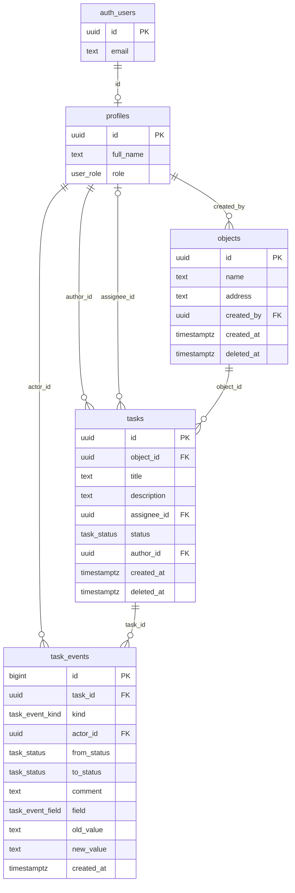

# База данных

Этот файл для разработчика. Источник правды: миграции в `supabase/migrations`, тесты в `supabase/tests`. База: PostgreSQL 17 в Supabase.

## Таблицы и связи

`auth_users` на схеме это таблица `auth.users` сервиса входа Supabase.

### `profiles`

Один профиль на пользователя. Роль хранится только здесь.

| Колонка | Тип | Что это |
|---|---|---|
| `id` | `uuid` | равен `auth.users.id` |
| `full_name` | `text` | имя, не пустое |
| `role` | `user_role` | `manager` постановщик, `worker` исполнитель |

### `objects`

Стройки.

| Колонка | Тип | Что это |
|---|---|---|
| `id` | `uuid` | ставит база |
| `name` | `text` | название, до 200 знаков |
| `address` | `text` | адрес, до 300 знаков |
| `created_by` | `uuid` | кто создал, ставит база |
| `created_at` | `timestamptz` | когда создан, ставит база |
| `deleted_at` | `timestamptz` | пусто у живого объекта, дата у удалённого |

### `tasks`

| Колонка | Тип | Что это |
|---|---|---|
| `id` | `uuid` | ставит база |
| `object_id` | `uuid` | объект |
| `title` | `text` | название, до 200 знаков |
| `description` | `text` | описание, до 5000 знаков, может быть пустым |
| `assignee_id` | `uuid` | исполнитель, может быть пустым только у статуса `new` |
| `status` | `task_status` | статус, меняет только `change_task_status` |
| `author_id` | `uuid` | автор, ставит база |
| `created_at` | `timestamptz` | дата создания, ставит база |
| `deleted_at` | `timestamptz` | пусто у живой задачи, дата у удалённой |

Ограничение `tasks_assignee_required`: `assignee_id is not null or status = 'new'`. Оно держит правило даже при выключенных триггерах, тест это проверяет.

### `task_events`

История задачи. Клиент её только читает.

| Колонка | Тип | Что это |
|---|---|---|
| `id` | `bigint` | номер записи |
| `task_id` | `uuid` | задача |
| `kind` | `task_event_kind` | вид записи |
| `actor_id` | `uuid` | кто сделал |
| `from_status`, `to_status` | `task_status` | откуда и куда, для видов `created` и `status` |
| `comment` | `text` | комментарий, если есть |
| `field` | `task_event_field` | какое поле правили, для вида `edit` |
| `old_value`, `new_value` | `text` | что было и что стало |
| `created_at` | `timestamptz` | когда, ставит база |

Что пишется и кем:

| `kind` | Когда | Кто пишет |
|---|---|---|
| `created` | задачу создали | триггер `tasks_journal_created` |
| `status` | сменили статус | функция `change_task_status` |
| `edit` | изменили название, описание, объект или исполнителя, одно событие на поле | триггер `tasks_journal_edit` |
| `deleted` | задачу удалили сами или вместе с объектом | функции `delete_task`, `delete_object` |

Для объекта и исполнителя в `old_value` и `new_value` лежат имена на момент правки: позже объект или человека могут переименовать. Пустой исполнитель хранится строкой `Не назначен`. Правка теми же значениями события не создаёт.

### Вид `task_board`

Списки и доски читают его. Это все поля `tasks` плюс данные о возвратах, поэтому сайту не нужен отдельный запрос на каждую карточку.

| Поле | Что это |
|---|---|
| `return_count` | сколько раз задачу возвращали, 0 если ни разу |
| `last_return_comment` | комментарий последнего возврата |
| `last_return_by` | кто вернул последним |
| `last_return_at` | когда вернули последний раз |

Вид «второй круг» считает сайт: `return_count > 0` и статус не `accepted`. Статус задачи при этом настоящий.

## Типы

| Тип | Значения |
|---|---|
| `user_role` | `manager`, `worker` |
| `task_status` | `new` Новая, `work` В работе, `review` На проверке, `rework` На доработке, `accepted` Принята |
| `task_event_kind` | `created`, `status`, `edit`, `deleted` |
| `task_event_field` | `title`, `description`, `object`, `assignee` |

## Функции

Те, что может вызвать вошедший пользователь (`supabase.rpc`):

| Функция | Что делает | Кто может |
|---|---|---|
| `change_task_status(p_task_id, p_to, p_comment)` | меняет статус и пишет событие, отдаёт новую строку задачи | по матрице, см. [docs/03-zashchita-dannyh.md](03-zashchita-dannyh.md) |
| `delete_task(p_task_id)` | ставит `deleted_at`, пишет событие `deleted` | постановщик |
| `delete_object(p_object_id)` | ставит `deleted_at` объекту и его неудалённым задачам, пишет событие `deleted` каждой из них | постановщик |

Служебные, в схеме `private`:

| Функция | Что делает |
|---|---|
| `is_manager()` | постановщик ли текущий пользователь, читает `profiles`. Доступна вошедшим: её вызывают политики |
| `my_object_ids()` | объекты, где у текущего пользователя есть неудалённая задача. Доступна вошедшим: её вызывает политика `objects_select` |
| `clean_text(...)` | убирает крайние пробелы и переводы строк, проверяет пустоту и длину, отвечает русским текстом |
| `status_label(...)` | русское название статуса для текста ошибки |
| `objects_before_write()`, `tasks_before_write()` | функции триггеров записи |
| `tasks_journal_created()`, `tasks_journal_edit()` | функции триггеров истории |
| `forbid_history_change()` | функция триггера неизменности истории |

У всех функций `security definer` задан пустой `search_path`, тест сверяет это по каталогу. Права на вызов снимаются явно в конце каждой миграции: новая функция по умолчанию открыта всем.

Обычная правка и создание идут напрямую через таблицы, функция для них не нужна: `from('tasks').update(...)`, `from('tasks').insert(...)`, `from('objects').insert(...)`, `from('objects').update(...)`. Лишнего клиент записать не может: права на колонки это запрещают.

## Триггеры

| Триггер | Таблица | Когда | Что делает |
|---|---|---|---|
| `objects_before_write` | `objects` | перед вставкой и правкой, на строку | только постановщик вставляет; ставит автора и время; запрещает править удалённый; чистит текст |
| `tasks_before_write` | `tasks` | перед вставкой и правкой, на строку | только постановщик вставляет; ставит статус, автора и время; запрещает править удалённую и снимать исполнителя не у «Новой»; проверяет, что объект живой; чистит текст |
| `tasks_journal_created` | `tasks` | после вставки, на строку | пишет событие `created` |
| `tasks_journal_edit` | `tasks` | после правки `title`, `description`, `object_id`, `assignee_id`, на строку | пишет по событию `edit` на изменённое поле |
| `task_events_immutable` | `task_events` | перед `update`, `delete`, `truncate`, на оператор | всегда отказывает |

Две блокировки защищают от гонок. `change_task_status` читает задачу с `for update`, поэтому два одновременных перехода идут по очереди. `tasks_before_write` читает объект с `for share`, поэтому задача не попадёт в объект, который удаляют в этот момент.

## Индексы

Индексы покрывают внешние ключи и порядок списков:

- `objects_created_by_idx`, `tasks_object_id_idx`, `tasks_assignee_id_idx`, `tasks_author_id_idx`, `task_events_actor_id_idx`: внешние ключи.
- `objects_live_idx`, `tasks_live_idx`: частичные, для неудалённых записей, по дате создания.
- `task_events_task_id_idx`: история внутри задачи.
- `task_events_returns_idx`: частичный, для возвратов, его использует `task_board`.

## Ошибки

Функции и триггеры отвечают кодом и русским текстом.

| Код | Текст | Когда |
|---|---|---|
| `P0001` | «Так нельзя: из «На проверке» задача идёт только в «Принята» или «На доработке».» (название статусов подставляется) | запрещённый переход |
| `P0001` | «Так нельзя: принятая задача больше не меняет статус.» | попытка сдвинуть принятую задачу |
| `P0002` | «Задача не найдена» | задачи нет, она удалена или человек её не видит |
| `P0002` | «Объект не найден» | объекта нет, он удалён, или задачу кладут в удалённый объект |
| `42501` | «Это действие доступно постановщику» | исполнитель принимает, возвращает, создаёт или удаляет |
| `42501` | «Это может сделать только назначенный исполнитель» | постановщик делает шаг исполнителя по чужой задаче |
| `42501` | «Историю нельзя изменить или удалить.» | запись в историю, остановленная триггером |
| `23514` | «Напишите, что нужно исправить: без комментария вернуть нельзя.» | возврат без комментария |
| `23514` | «Снять исполнителя можно только у новой задачи.» | снятие исполнителя не у «Новой» |
| `23514` | «Название не может быть пустым.», «Адрес не может быть пустым.» | пустое поле |
| `23514` | «Название: не больше 200 знаков.», «Адрес: не больше 300 знаков.», «Описание: не больше 5000 знаков.», «Комментарий: не больше 2000 знаков.» | слишком длинный текст |

Как их показывает сайт (`src/shared/api/errors.ts`):

- Если текст русский, сайт показывает его как есть. Сам код человеку не показывается.
- Те же коды база отдаёт и без наших функций, с английским текстом. Например, нет прав на колонку даёт `42501`. Тогда сайт показывает общую фразу: «Это действие вам недоступно.»
- Нет связи и ошибка сервера дают общий текст и возможность повторить. Истёкший вход просит войти снова.
- Правка чужой записи под RLS даёт 0 строк без ошибки. Сайт запрашивает одну строку после правки, получает код `PGRST116` и показывает «Запись не найдена или у вас нет к ней доступа.»

## Тесты и что они доказывают

Тесты базы написаны на pgTAP (библиотека тестов прямо внутри PostgreSQL). Они переключаются на роль `authenticated`, `anon` или `service_role`, подставляют данные входа так же, как это делает API, и выполняют команды SQL. В конце каждого файла всё откатывается. Через настоящий API и сервис входа эти тесты не ходят.

Запуск: `npx supabase test db`. Всего 351 проверка в 4 файлах, все проходят (прогон 5 ноября 2026).

| Файл | Проверок | Что доказывает |
|---|---|---|
| `01_transitions.test.sql` | 151 | Полная матрица 125 сочетаний: кто, откуда, куда. Тексты ошибок. Комментарий при возврате: пусто, пробелы, переводы строк. Подделка роли в токене. Полный путь со вторым кругом. Постановщик назначает себя, выполняет и принимает |
| `02_access.test.sql` | 97 | Периметр по каталогу базы: RLS на всех таблицах, права `anon`, точный список колонок, набор функций. Чужое не читается и не пишется. Постановщик и секретный ключ не могут писать защищённые колонки. Видимость объекта идёт за задачей. Поля возвратов в `task_board` |
| `03_history_and_edits.test.sql` | 90 | Автора и время ставит база, даже при обходе прав. Журнал правок с понятными значениями. Снятие исполнителя только у «Новой». История не меняется ни у клиента, ни у секретного ключа, ни у владельца. Удаление скрывает и не стирает, удалённое не правится |
| `04_demo_data.test.sql` | 13 | Демо-данные как задумано: 3 пользователя, 3 объекта, 9 задач, 27 записей истории, цепочка статусов без разрывов. Пётр видит 3 задачи и 2 объекта, Сергей 5 задач и 2 объекта |

Общая подготовка лежит в `fixture.psql`: два постановщика, два исполнителя, пользователь без профиля, три объекта, четыре задачи.

Правило для матрицы записано в тесте отдельно от кода функции. Поэтому ошибка в функции не повторится в тесте: тест её поймает.

### Проверка самих тестов

Разово, скриптом вне репозитория, в код базы вносили порчи: ломали матрицу, роли, комментарий, журнал, права, политики, триггеры. Всего 63 порчи. Тесты поймали все 63.

### Демо-данные

| Что | Сколько |
|---|---|
| Объекты | ЖК Северный, Склад на Южной, Коттедж Берёзки |
| Задачи по статусам | Новая 2, В работе 2, На проверке 3, На доработке 1, Принята 1 |
| Задача без исполнителя | 1 |
| Задачи второго круга | 2 |
| Записи истории | 27 |

Файлы:

- `supabase/seed.sql`: только локальная база, три пользователя без пароля.
- `supabase/demo-data.sql`: объекты, задачи, история. Одна команда: загружается целиком или никак. Повторный запуск ничего не меняет.
- `scripts/seed-users.mjs`: создаёт или обновляет пользователей с паролем и их профили.

Время в демо-данных записано в поясе +05. В другом поясе часы на экране сдвинутся, порядок записей не изменится.
